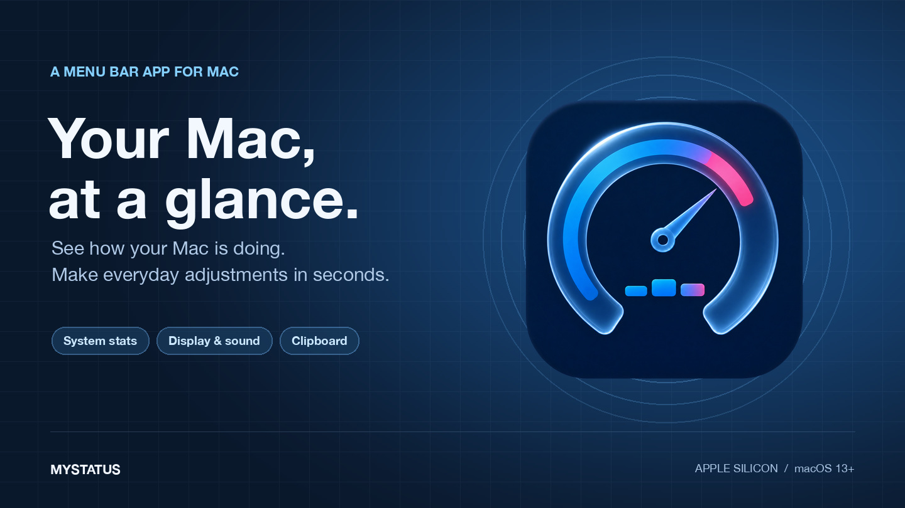
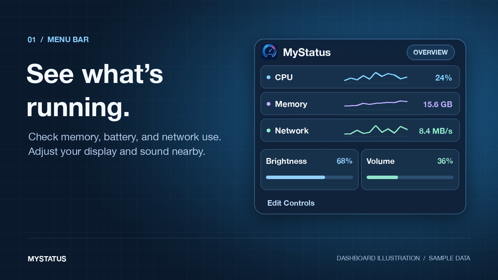
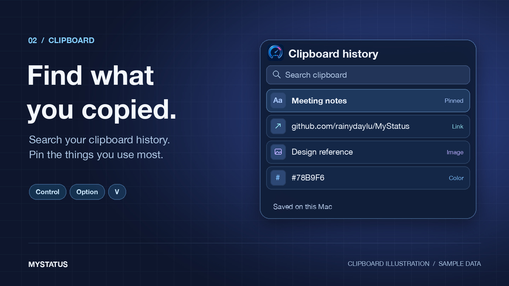

# MyStatus

See how your Mac is doing, adjust your screen and sound, and find things you’ve copied, all from the menu bar.

**[↓ Download MyStatus for Mac](https://github.com/rainydaylu/MyStatus/releases/download/v1.0.0/MyStatus-1.0.0.zip)** · [Release notes](https://github.com/rainydaylu/MyStatus/releases/tag/v1.0.0) · [简体中文](README.zh-CN.md)

For **Apple silicon Macs (M1 or newer)** running **macOS 13 or later**.



## Install and open

1. Download the ZIP using the link above and double-click it to unzip.
2. Drag **MyStatus.app** into your **Applications** folder.
3. Open **MyStatus**, then click its icon in the menu bar at the top of your screen.

If macOS shows a message about verifying the developer, see [Apple’s guide to opening apps safely](https://support.apple.com/en-us/102445). This build has not been notarized by Apple.

## Try these first

- **Check what’s using your Mac.** See memory, battery, and network activity at a glance. Hover over a tile to see more detail.
- **Adjust your screen and sound.** Open **Display** or **Sound** to change brightness or volume. External monitor controls depend on your setup.
- **Find something you copied.** Press **Control–Option–V** to open clipboard history. Search for an item or pin it for later. Your history stays on your Mac.
- **Make it yours.** Click **Edit Controls** to choose which tiles to show and drag them into the order you want. On macOS 26, you can also adjust the Liquid Glass appearance.

<p>
  
  
</p>

*Illustrations use sample data.*

## Optional extras

Open **Edit Controls** to turn on these extras.

- **Hanging Clipboard** keeps screenshots and copied images within reach at the top of the screen.
- **Mos** makes mouse-wheel scrolling smoother and lets you adjust its speed and direction.
- **CodeIsland** shows supported AI coding sessions in a small panel near the top of the screen.

MyStatus is made by [rainydaylu](https://github.com/rainydaylu). See [third-party credits and licenses](THIRD_PARTY_NOTICES.md), including the noncommercial license for the bundled Mos code. [Report a problem](https://github.com/rainydaylu/MyStatus/issues).

## For developers

<details>
<summary>Build from source, run tests, and write plugins</summary>

Use Xcode Command Line Tools with Swift 6 or later. The macOS 26 SDK enables Liquid Glass when building the app.

```bash
git clone https://github.com/rainydaylu/MyStatus.git
cd MyStatus
./scripts/build-app.sh --no-launch
open build/MyStatus.app
```

Run the tests with `./scripts/test.sh`. For plugin development, start with the [Keep Awake example](Examples/KeepAwakePlugin) and [StatusDeckKit](Packages/StatusDeckKit).

</details>
