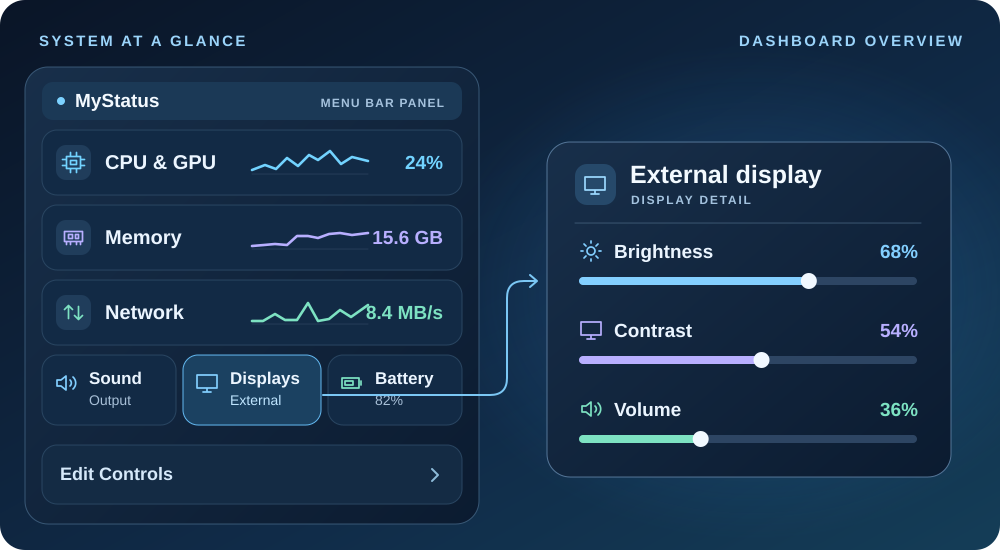

<p align="center">
  
</p>

<h1 align="center">MyStatus</h1>

<p align="center">
  A modular macOS menu bar dashboard for system monitoring, display and audio controls, and everyday tools.
</p>

<p align="center">
  <a href="#get-started"><strong>Build MyStatus</strong></a> ·
  <a href="#what-you-can-do">Features</a> ·
  <a href="#bundled-extensions">Extensions</a> ·
  <a href="README.zh-CN.md">简体中文</a>
</p>



*Illustrated overview with sample readings.*

## What you can do

| | In the menu bar and dashboard |
| --- | --- |
| **Monitor your Mac** | See CPU and GPU load, memory pressure and swap, disk activity, network throughput, temperatures, fan speeds, and battery health. Hover over a tile for the detailed view. |
| **Control displays and sound** | Adjust brightness and contrast on compatible DDC/CI monitors, switch audio inputs and outputs, and control supported display volume from the panel or keyboard. |
| **Find something you copied** | Open clipboard history with **Control–Option–V**. Search by content or source app, filter by type, and pin items you use often. |
| **Choose what stays visible** | Open **Edit Controls** to enable plugins and drag to reorder dashboard tiles. Use the combined battery, Wi-Fi, and volume icon or add menu bar readouts for CPU, memory, and network speed. |
| **Tune the panel** | Choose light, dark, or system appearance. On macOS 26, adjust the Liquid Glass panel’s background depth and blur in **Preferences**. Earlier macOS versions use a frosted appearance. |

## Get started

MyStatus targets **macOS 13 or later**. The source build requires Xcode Command Line Tools with Swift 6 or newer. Use the current macOS SDK to build with Liquid Glass support.

```bash
git clone https://github.com/rainydaylu/MyStatus.git
cd MyStatus
./scripts/build-app.sh --no-launch
open build/MyStatus.app
```

Click the MyStatus icon in the macOS menu bar. Hover over a tile to open its detail pane, or choose **Edit Controls** to configure the dashboard. The app bundle produced by the build script uses ad hoc signing.

## Bundled extensions

| Extension | What it adds |
| --- | --- |
| [Hanging Clipboard](Extensions/HangingClipboardPlugin) | Keeps screenshots and copied images at the top of the screen for quick preview, drag-and-drop, and annotation. |
| [Mos](Extensions/MosPlugin) | Smooths mouse-wheel scrolling, with separate direction, speed, and duration settings and per-app exclusions. |
| [CodeIsland](Extensions/CodeIslandPlugin) | Shows supported local AI coding sessions in a notch-style panel. |

Open **Edit Controls → Plugin updates** to check for compatible updates to these extensions. MyStatus builds the update from a specific upstream commit using the installed adapter. A failed build leaves the current plugin in place.

## Permissions and compatibility

- **Display controls.** DDC/CI support varies by Mac, monitor, and connection. For compatible HDMI and DisplayPort audio outputs, software volume uses a Core Audio tap on macOS 14.2 or later. macOS requests system audio access for that mode. MyStatus processes the stream in memory without saving audio.
- **Keyboard and mouse.** Accessibility access enables the display media-key controls and Mos mouse-wheel handling. Brightness keys target the supported external display under the pointer. Volume keys follow the active output.
- **Clipboard.** Clipboard history stays on the Mac in an unencrypted, user-only store. You can pause capture, clear history, or exclude apps. MyStatus skips clipboard items marked as confidential or transient.
- **Hardware and OS versions.** The bundled Hanging Clipboard and CodeIsland targets require macOS 14 or later. Sensor readings and manual fan control depend on hardware support. Changing fan speed or Low Power Mode can require administrator approval.
- **Languages.** English, Simplified Chinese, Traditional Chinese, French, German, Japanese, and Korean.

## Develop a plugin

[StatusDeckKit](Packages/StatusDeckKit) provides the plugin API and reusable SwiftUI controls. Start with the [Keep Awake example](Examples/KeepAwakePlugin) and use `./scripts/build-plugin.sh Examples/KeepAwakePlugin` to build it. Install trusted `.deckplugin` bundles in `~/Library/Application Support/StatusDeck/Plugins/` and rescan from settings. Third-party plugins run inside MyStatus with its permissions.

Run the test suite with `./scripts/test.sh`. For issues and feature requests, use [GitHub Issues](https://github.com/rainydaylu/MyStatus/issues).

## Credits and licenses

MyStatus is developed by [rainydaylu](https://github.com/rainydaylu). See the [third-party notices](THIRD_PARTY_NOTICES.md) for upstream projects, attribution, and license details. The bundled Mos adapter incorporates [CC BY-NC 4.0](https://creativecommons.org/licenses/by-nc/4.0/) code and is distributed for noncommercial use.
