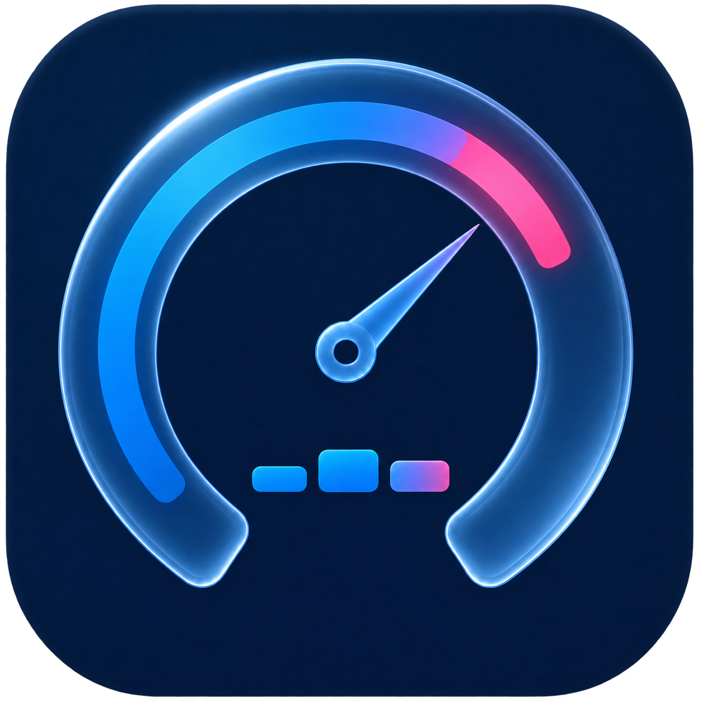
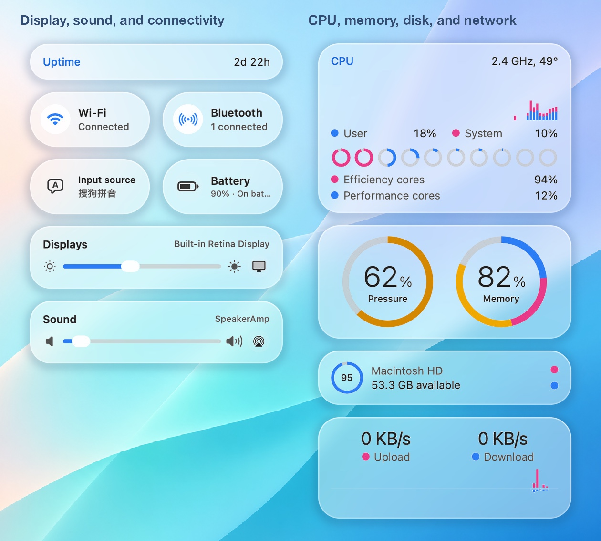
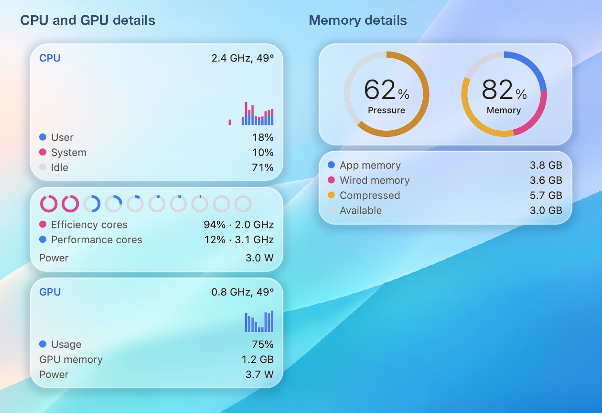
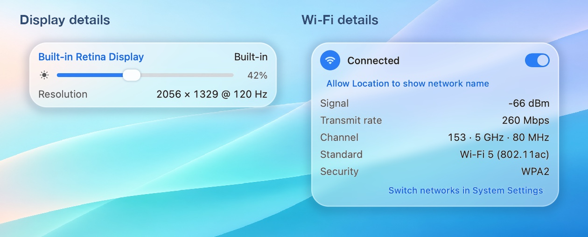
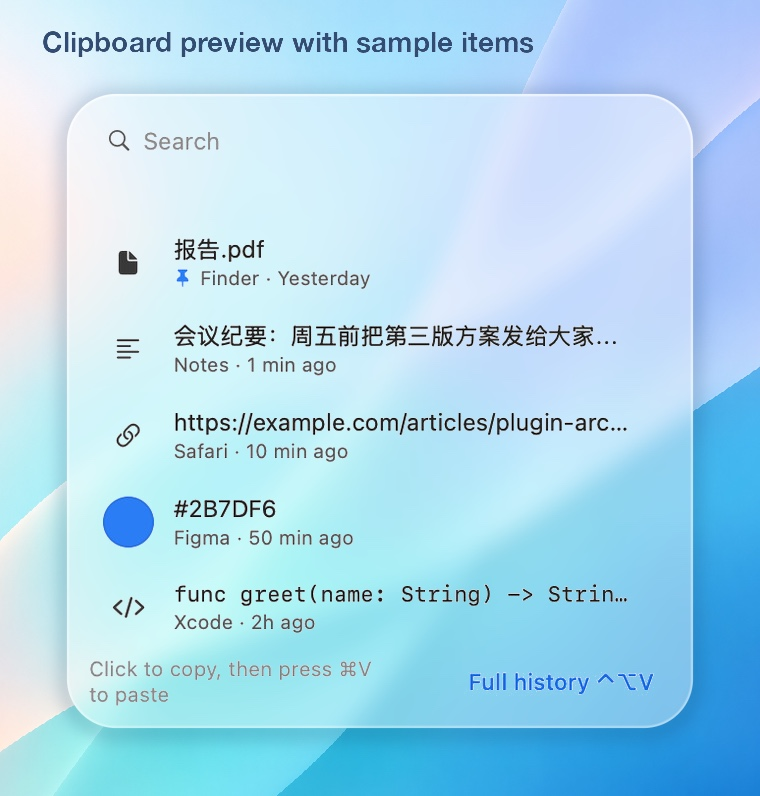
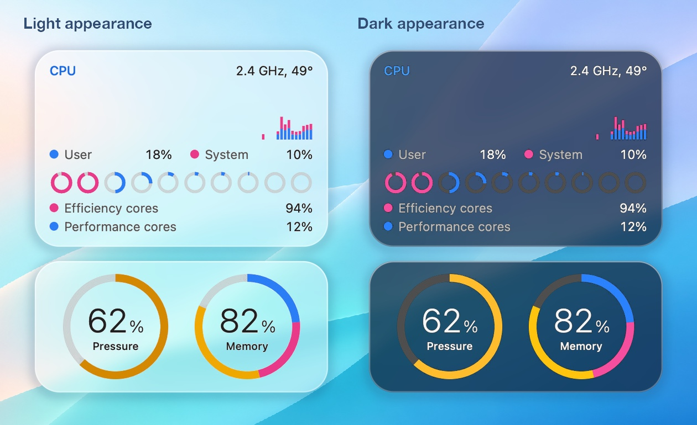

<p align="center">
  
</p>

<h1 align="center">MyStatus</h1>

<p align="center">
  <strong>从菜单栏掌握 Mac 状态。</strong> 查看系统负载，调节屏幕和音量，找回刚才复制的内容。
</p>

<p align="center">
  <a href="https://github.com/rainydaylu/MyStatus/releases/latest#assets"></a>
  &nbsp;
  <a href="https://github.com/rainydaylu/MyStatus/releases/latest"></a>
</p>

<p align="center">
  <em>v1.2.4 · Apple 芯片 Mac（M1 或更新）· macOS 13 或更新版本</em>
  <br>
  <a href="README.md">English</a>
</p>

<p align="center">
  <a href="#安装与上手">安装与上手</a> &nbsp;·&nbsp;
  <a href="#查看系统状态">系统状态</a> &nbsp;·&nbsp;
  <a href="#显示声音与连接">显示与声音</a> &nbsp;·&nbsp;
  <a href="#查找剪贴板内容">剪贴板</a> &nbsp;·&nbsp;
  <a href="#自定义面板">自定义</a> &nbsp;·&nbsp;
  <a href="#从源码构建">源码构建</a>
</p>

<p align="center">
  
  <br>
  <em>以 MyStatus 菜单栏面板的两个区段合成的玻璃材质示意。</em>
</p>

---

## 安装与上手

1. **下载并解压。** 点击页面顶部的「下载 Mac 版」，在最新发行版的 **Assets（附件）** 中选择 MyStatus ZIP，再到访达里双击解压。
2. **移入「应用程序」。** 把 **MyStatus.app** 拖到「应用程序」文件夹，然后打开它。
3. **打开菜单栏面板。** 点击屏幕顶部菜单栏中的 MyStatus 状态图标。悬停或点击任意卡片，即可查看详情，也支持直接触控。

可以先看看 **内存**、**显示器** 或 **声音**。主面板显示常用读数和控制项，详情面板里还有图表、设备列表和更多设置。点击底部的 **编辑控制**，就能选择要显示的卡片。

> **首次打开。** 如果 macOS 提示无法验证开发者，请参阅 [Apple 的安全打开应用指南](https://support.apple.com/zh-cn/102445)。此发行包未经 Apple 公证。

## 查看系统状态

<p align="center">
  
  <br>
  <em>左侧是 CPU 和 GPU 详情，右侧是内存压力和用量。</em>
</p>

| 卡片 | 怎么看 |
| --- | --- |
| **CPU** | 柱状图显示最近的使用情况，蓝色是用户进程，粉色是系统进程。下方小圆环对应各个核心。将鼠标移到卡片上可展开 CPU 和 GPU 详情。 |
| **内存** | 两个圆环分别显示内存压力和用量。如果 Mac 变慢，可以先看压力，了解系统为应用腾出内存的难度。详情还列出应用内存、联动内存、压缩内存和交换空间用量。 |
| **磁盘** | 查看剩余空间和读写速度，展开详情可分卷查看，也可查看读写历史及系统可提供的进程读写数据。 |
| **网络** | 查看当前上传、下载速度以及近期曲线。详情里可查看启动以来的流量、正在使用的网络接口及系统可提供的进程网络活动。 |
| **传感器与电池** | 根据 Mac 支持的项目，查看温度、风扇转速、电量和电池健康度。悬停在风扇或传感器读数上可查看历史。电池详情还可显示循环次数和供电情况。 |

在详情面板中，将鼠标移到支持的图表或读数上，可展开更大的历史图。部分图表支持选择 1 分钟到 5 小时的时间范围。悬停在图上可查看采样值。

## 显示声音与连接

主面板上可以直接拖动 **显示器** 和 **声音** 滑块。展开详情即可确认正在调节的显示器或音频设备。

<p align="center">
  
  <br>
  <em>把鼠标移到显示器或 Wi-Fi 卡片上，即可展开对应详情。</em>
</p>

- **显示器。** 可调节内建屏幕及兼容外接显示器的亮度。部分外接显示器也支持对比度控制，具体取决于显示器和连接方式。
- **声音。** 可切换音频输入和输出设备，也可调节兼容的 HDMI 或 DisplayPort 音频输出。显示器无法接收音量指令时，macOS 14.2 或更新版本可对受支持的输出使用 **软件音量**。
- **Wi-Fi 和蓝牙。** 查看连接状态、Wi-Fi 信号和信道，以及兼容蓝牙设备的电量。要连接另一条 Wi-Fi 网络，请打开 **系统设置**。
- **键盘亮度和音量键。** 开启后可用键盘调节受支持的外接显示器亮度和音频输出音量。启用此功能时，macOS 会要求授予辅助功能权限。

## 查找剪贴板内容

按 <kbd>Shift</kbd> + <kbd>Command</kbd> + <kbd>V</kbd> 打开剪贴板历史。可以搜索、按类型或来源筛选、置顶，以及创建彩色标签。悬停或点击条目展开预览；双击按原始格式复制一次并关闭剪贴板，<kbd>Esc</kbd> 一次关闭侧栏和详情。右键菜单中的 **仅复制文本** 可去掉格式。选中条目后也可按 <kbd>Return</kbd> 再次使用；如果内容已复制而未粘贴，可在目标位置按 <kbd>Command</kbd> + <kbd>V</kbd> 粘贴。

<p align="center">
  
  <br>
  <em>剪贴板预览使用应用内置的示例条目。</em>
</p>

剪贴板历史保存在本机仅当前用户可访问的文件夹中，采用未加密存储。你可以暂停记录、清除历史，或排除指定应用。来源应用标记为保密或临时的内容会自动跳过。

## 自定义面板

在 **编辑控制** 中，可以开关卡片或拖动排序。菜单栏默认显示电池、Wi-Fi 和音量的组合图标，以及实时网速。CPU 和内存读数默认关闭，可在「菜单栏读数」设置中分别开启。

在 **偏好设置** 中可选择浅色、深色或跟随系统，并调整卡片透明度、背景深度和模糊。macOS 26 使用 Liquid Glass，较早版本使用磨砂效果。

<p align="center">
  
  <br>
  <em>浅色与深色材质示意。应用中的玻璃效果会随面板后方的内容变化。</em>
</p>

### 可选扩展

| 扩展 | 功能 |
| --- | --- |
| **悬浮剪贴板（Hanging Clipboard）** | 把截图和复制的图片放在屏幕顶部，便于预览、拖放和标注。 |
| **Mos** | 让鼠标滚轮更平滑，可单独调整方向，并为不同应用设置例外。 |
| **CodeIsland** | 在屏幕顶部的小面板中查看受支持的本地 AI 编程会话。 |

在 **编辑控制** 中启用需要的扩展，使用 **插件更新** 检查上游版本。悬浮剪贴板和 CodeIsland 需要 macOS 14 或更新版本。

---

## 权限与常见问题

| 想使用的功能 | 在哪里设置 |
| --- | --- |
| 用键盘调节外接显示器或使用 Mos | 在 **系统设置 → 隐私与安全性 → 辅助功能** 中允许 MyStatus。 |
| 使用软件音量 | 按 macOS 提示允许访问系统音频。应用使用音频流调节播放音量，不保存录音。 |
| 显示 Wi-Fi 网络名称 | 按提示授予定位权限。未授权时仍可查看连接状态。 |
| 调节风扇或低电量模式 | 取决于硬件支持，macOS 可能需要管理员授权。 |
| 反馈问题 | 请附上 macOS 版本、Mac 机型和出现问题的功能。[在 GitHub 提交问题](https://github.com/rainydaylu/MyStatus/issues)。 |

## 从源码构建

<details>
<summary>构建应用、运行测试与开发插件</summary>

安装包含 Swift 6 或更新版本的 Xcode 命令行工具。构建支持 Liquid Glass 的版本时，请使用 macOS 26 SDK。

```bash
git clone https://github.com/rainydaylu/MyStatus.git
cd MyStatus
./scripts/build-app.sh --no-launch
open build/MyStatus.app
```

运行 `./scripts/test.sh` 执行测试。插件开发可以从 [StatusDeckKit](Packages/StatusDeckKit) 和 [Keep Awake 示例](Examples/KeepAwakePlugin) 开始。第三方插件在 MyStatus 内运行，并拥有应用的权限。

</details>

---

<p align="center">
  由 <a href="https://github.com/rainydaylu">rainydaylu</a> 开发 &nbsp;·&nbsp;
  <a href="THIRD_PARTY_NOTICES.md">第三方署名与许可证</a>
  <br>
  <em>随附的 Mos 代码采用非商业用途许可证。</em>
</p>
